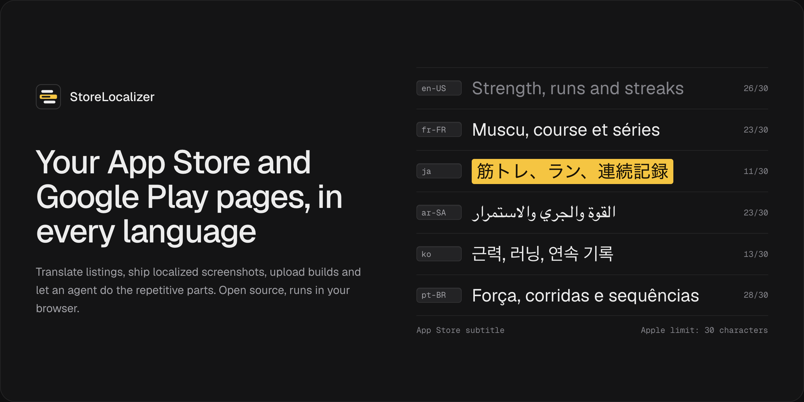
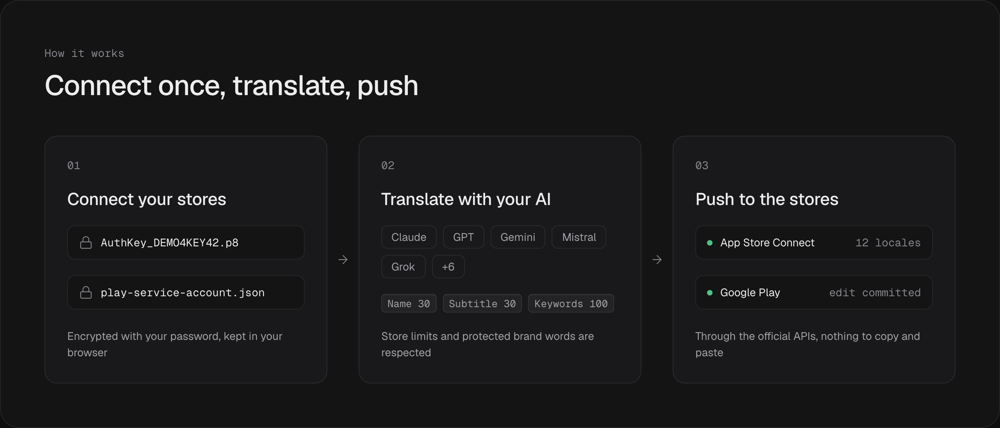
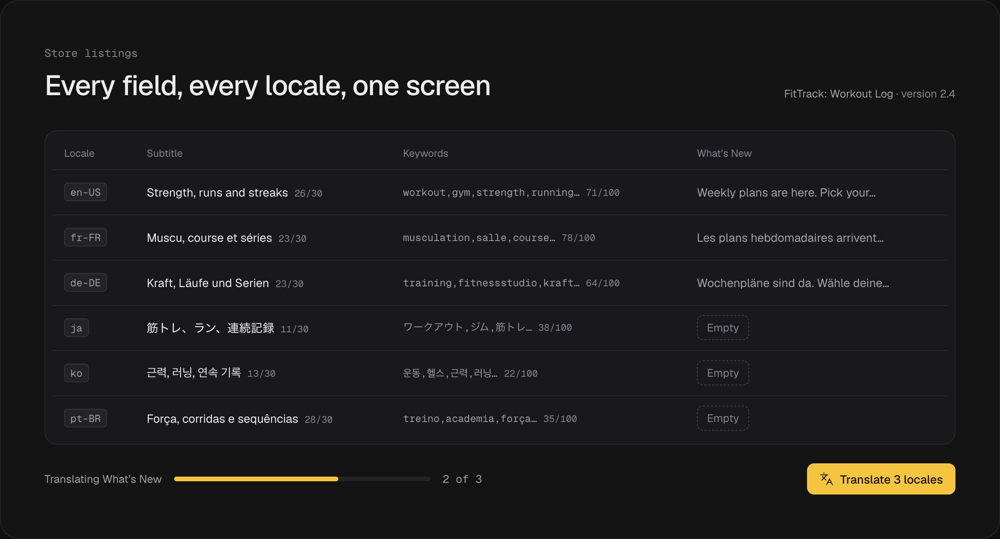
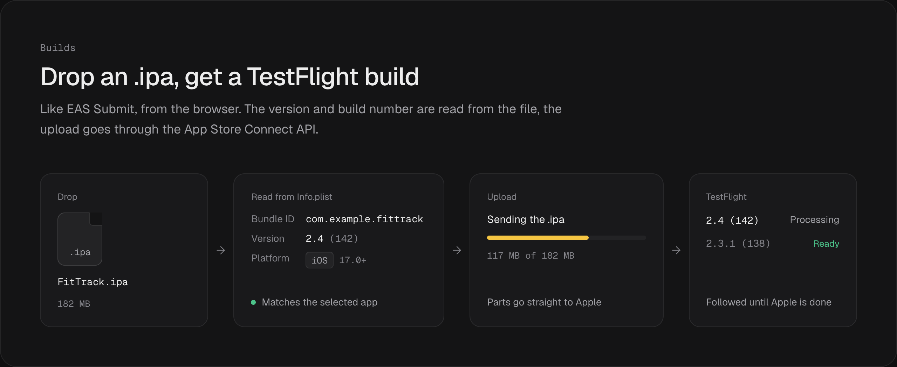
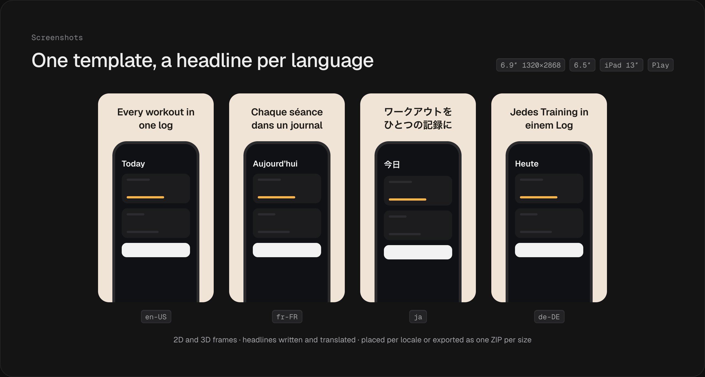
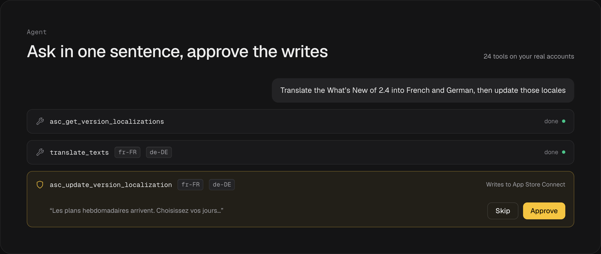
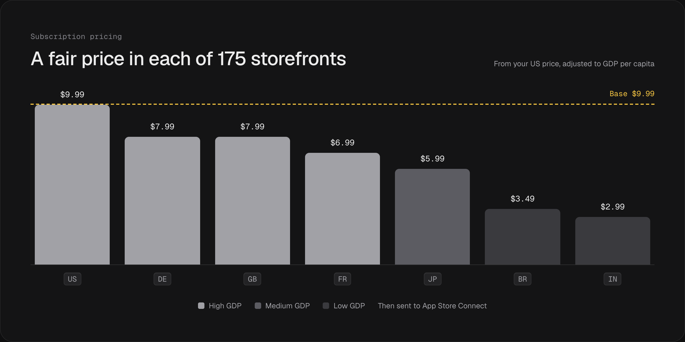
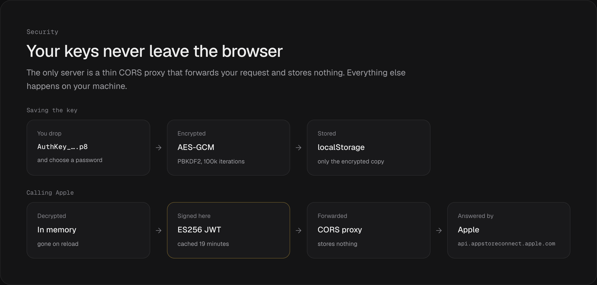

<div align="center">

# StoreLocalizer

**Your App Store and Google Play pages, in every language.**

Connect App Store Connect and the Google Play Console with your own keys, translate your listings with the AI provider you choose, build screenshots for each locale, drop an `.ipa` to get a TestFlight build, and let an agent handle the repetitive parts. Subscription pricing and `.xcstrings` catalogs come along. Open source, runs in your browser.

[**Open the app**](https://storelocalizer.com/) · [Run it locally](#run-it-locally) · [How your keys stay safe](#your-keys-stay-in-the-browser)

Works with App Store Connect, the Google Play Console and [AppCompete](https://appcompete.com) for ASO keyword data.

[](https://github.com/fayharinn/StoreLocalizer/stargazers)
[](https://www.gnu.org/licenses/agpl-3.0.html)
[](https://github.com/fayharinn/StoreLocalizer/commits/main)



</div>

## How it works

<div align="center"></div>

## Why

Shipping an app in another country is mostly copy and paste:

|  | By hand | With StoreLocalizer |
|---|---|---|
| Store listings in every locale | Pasting into App Store Connect and the Play Console, field by field | Written per locale and pushed through the official APIs |
| Screenshots per language | A designer and a lot of exports | One template, a headline per language, placed per locale or exported as one ZIP |
| Builds | Xcode Organizer or Transporter on a Mac | Drop the `.ipa` in the browser, follow it to TestFlight |
| The repetitive parts | Clicking through the same screens every release | An agent that does it from one sentence and asks before every write |
| ASO keywords per locale | A spreadsheet that goes stale | Suggestions scored by popularity and difficulty with [AppCompete](https://appcompete.com) data, reviewed one by one |
| Prices in 175 storefronts | Guesswork, or the same price everywhere | A price per storefront from your US base price, adjusted to local purchasing power |
| Your app’s own strings | Weeks of spreadsheets and copy-paste | One `.xcstrings` file in, the same file out with every missing string filled |

It talks to App Store Connect and the Google Play Console directly, with your own keys. No account, no export step.

## What it does

Everything starts from Home: your two stores, the screenshot studio and the agent, each one click away.

### App Store Connect and Google Play

Connect once with your API keys, then translate name, subtitle, description, keywords, promotional text and What’s New across every locale, create versions, and push it all back without leaving the browser.

- **Asset Library** — upload screenshots, app previews and creative assets once, then place them on any surface. Sizes and device groups come live from Apple’s spec catalog, iPhone Duo included, and a dropped `/en-US`, `/fr-FR`… folder is checked, uploaded and placed per locale in one go.
- **Custom Product Pages** — create, publish or hide and deep-link page variants, translate their promotional text, and fill their media from the library.
- **Product Page Optimization** — set up A/B tests with up to three treatments (alternate icon and media per locale) and start them once Apple accepts them.
- **In-App Events** — create, localize and translate events, with their card and details page artwork.

<div align="center"></div>

### Builds, like EAS Submit

Drop an `.ipa` on the Builds tab of the App Store page. StoreLocalizer reads the bundle ID, version and build number from its `Info.plist`, checks it matches the selected app, sends it through the App Store Connect build upload API and follows it until Apple has processed it for TestFlight. No Xcode, no Transporter, no CI step.

<div align="center"></div>

### Screenshot studio

A device-frame screenshot generator next to your translations: 2D and 3D frames, background presets, headlines generated for your app and translated into every project language, then one ZIP per store size.

<div align="center"></div>

### An agent for the busywork

Ask in plain words and it calls 24 functions against your real accounts: list apps and versions, audit localizations, translate and push What’s New to five locales, mine ASO keywords from [AppCompete](https://appcompete.com), or find what is missing in your `.xcstrings`. It can look at your App Store screenshots and review each one. Every write waits for your approval.

<div align="center"></div>

### ASO keywords that earn their 100 characters

Generate keywords per locale, or connect your [AppCompete](https://appcompete.com) account to work with real data: suggestions scored by popularity and difficulty against Apple’s 100-character limit, keywords mined from the competitors you track, and a review of every keyword that tells you what to keep and what to replace.

### Subscription prices by purchasing power

Set your US base price and get a recommended price for each of the 175 storefronts, adjusted to local GDP per capita. Push them to App Store Connect and translate your subscription display names on the way.

<div align="center"></div>

### String catalogs

Your app’s own strings come along too. Drop the `Localizable.xcstrings` file from your Xcode project, tick the languages you want, and translate. Each language shows how much of the catalog is already done. Format specifiers like `%lld` and `%@` and the brand words you protect stay exactly as they are, and batched, parallel requests get through a thousand strings in a few minutes. Every cell stays one click away from a manual fix, then the file goes back to Xcode.

## Bring your own AI

Pick a provider in the sidebar and paste a key. Keys go from your browser to the provider and nowhere else.

| Provider | Models | Notes |
|---|---|---|
| OpenAI | gpt-6-luna · gpt-6.1-sol · gpt-6-astra | model list read from your account |
| Anthropic | claude-haiku-5-5 · claude-sonnet-5-5 · claude-opus-5-5 | direct browser access |
| Google Gemini | gemini-3.8-flash · gemini-3.6-flash · gemini-3.1-pro-preview | JSON-native responses |
| xAI | grok-4.7 · grok-4.6 · grok-4.3 | |
| Mistral | mistral-small · mistral-medium · mistral-large | |
| DeepSeek | deepseek-v4-flash · deepseek-v4-pro | |
| OpenRouter | any model on your account | |
| Cloudflare Workers AI | Llama 3.3 and 4 · GPT-OSS · Qwen 3 | open-weight models |
| AWS Bedrock | Claude family | bearer-token auth |
| Azure OpenAI | your deployments | |
| GitHub Models | gpt-4o · gpt-5.6-luna | free tier friendly |

The agent needs function calling: OpenAI, Anthropic, Gemini, xAI, Mistral, OpenRouter, Azure, Bedrock, GitHub Models and DeepSeek all work.

## Run it locally

```bash
git clone https://github.com/fayharinn/StoreLocalizer.git
cd StoreLocalizer
bun install        # or npm install
bun run dev        # http://localhost:5173
```

The dev server proxies every App Store Connect and Google Play call for you, so that is all you need for local use. Nothing to install? Use the hosted version at [storelocalizer.com](https://storelocalizer.com/).

Desktop app (Tauri 2, needs the Rust toolchain):

```bash
bun run tauri:dev      # develop
bun run tauri:build    # package
```

## Connect your stores

Add as many App Store Connect keys and Google Play service accounts as you need, one per developer account or client, and switch between them from the sidebar. They are all saved encrypted under one password.

<details>
<summary><b>App Store Connect API key</b></summary>

1. Open [App Store Connect, Integrations, API Keys](https://appstoreconnect.apple.com/access/integrations/api)
2. Create a key with the **Admin** or **App Manager** role
3. Note the **Key ID** and **Issuer ID**, and download the `.p8` file
4. Drop everything in the sidebar. The `.p8` is encrypted with your password before it is stored

</details>

<details>
<summary><b>Google Play service account</b></summary>

1. In the [Google Cloud Console](https://console.cloud.google.com/), create a service account with the **Google Play Developer API** enabled and download its JSON key
2. In the Play Console, under **Users and permissions**, invite the service account email
3. Grant **Admin** or **Release manager** for your app
4. Drop the JSON key in the sidebar

</details>

<details>
<summary><b>AppCompete API key (optional, for ASO data)</b></summary>

1. Sign in on [appcompete.com](https://appcompete.com)
2. Open **Connect AppCompete to your AI client** and click **Generate**. The key (`ac_live_…`) shows only once, so copy it right away
3. Paste it in the AppCompete section of the sidebar. Keyword suggestions, competitor mining, keyword review and the rank tracker use it from then on

</details>

## Your keys stay in the browser

<div align="center"></div>

**In one paragraph:** your `.p8` key is encrypted in the browser (AES-GCM, PBKDF2 with 100k iterations) before it touches `localStorage`, and the decrypted key only ever exists in memory. JWTs are signed client side with [jose](https://github.com/panva/jose). AI provider keys go straight from your browser to the provider. The only backend is a thin CORS proxy that forwards your `Authorization` header and stores nothing. It is all open source, so you can check every line.

## Production deployment

The web app is static (Vite). Apple and Google block browser CORS, so production needs the bundled Cloudflare Worker as a proxy:

```bash
# 1. Deploy the CORS proxy worker
wrangler deploy -c wrangler.proxy.jsonc

# 2. Point the site at it
echo 'VITE_ASC_PROXY_URL=https://your-worker.workers.dev' >> .env.production
echo 'VITE_GP_PROXY_URL=https://your-worker.workers.dev'  >> .env.production

# 3. Ship the site
bun run deploy:cloudflare   # Cloudflare Pages
bun run deploy              # or GitHub Pages
```

Add your domain to `ALLOWED_ORIGINS` in [worker/index.js](worker/index.js).

## Tech stack

React 19 and Vite · Tailwind and shadcn/ui · Geist · Three.js for 3D device frames · jose for ES256 JWT signing in the browser · Tauri 2 for the desktop app · Cloudflare Workers for the CORS proxy

```text
src/
├── components/        # six pages: agent · xcstrings · appstore · googleplay · screenshots · subscriptions
├── hooks/             # top-level state (useAppState, useTranslation, …)
├── services/          # every external call: ASC, Google Play, 11 AI providers, AppCompete and the agent's tools
└── utils/             # xcstrings parser, AES-GCM crypto
```

## Contributing

Issues and pull requests are welcome. Run `bun run lint` before you open one. The illustrations in this README are drawn in [docs/readme/cards.html](docs/readme/cards.html) and rendered with `node scripts/render-readme-cards.mjs`.

### Contributors

<!-- contributors:start -->
<table>
  <tbody>
    <tr>
      <td align="center">
        <a href="https://github.com/fayharinn">
          <br />
          <sub><b>fayharinn</b></sub>
        </a>
      </td>
      <td align="center">
        <a href="https://github.com/krrskl">
          <br />
          <sub><b>krrskl</b></sub>
        </a>
      </td>
      <td align="center">
        <a href="https://github.com/jtaxiexpress">
          <br />
          <sub><b>jtaxiexpress</b></sub>
        </a>
      </td>
      <td align="center">
        <a href="https://github.com/isnine">
          <br />
          <sub><b>isnine</b></sub>
        </a>
      </td>
      <td align="center">
        <a href="https://github.com/mashegoindustries">
          <br />
          <sub><b>mashegoindustries</b></sub>
        </a>
      </td>
    </tr>
  </tbody>
</table>
<!-- contributors:end -->

*This grid refreshes on every push.*

**Credits:** the screenshot generator started from [appscreen](https://github.com/YUZU-Hub/appscreen) by Stefan from yuzuhub.com.

## License

[AGPL-3.0](LICENSE). Free to use, change and self-host; derivatives stay open source.

<div align="center">

Made by **[Fayhe](https://github.com/fayharinn)**. If it saves you a localization weekend, a star helps other developers find it.

</div>
